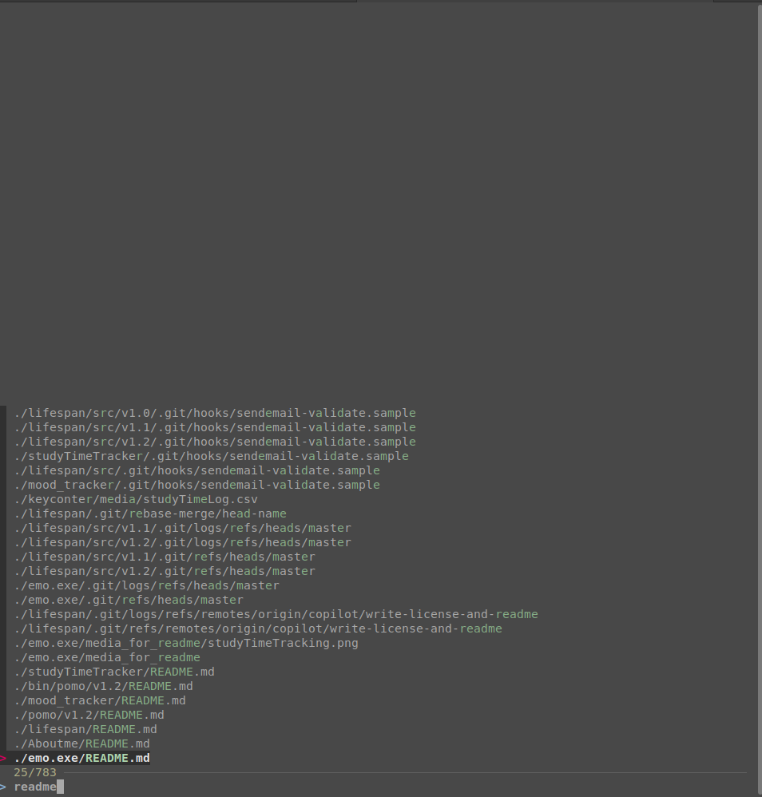
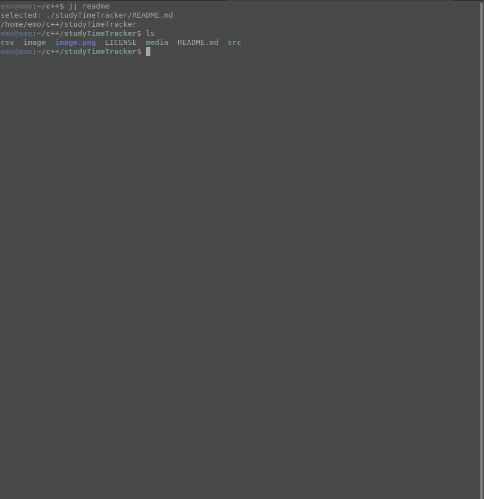

# jj





**jj** is a lightweight, terminal-friendly companion to `find | grep`.
It helps you locate files fast and jump straight into the right directory.

## ✨ Features

- Fast file discovery with fuzzy matching
- Jump directly to the selected file’s folder
- Simple shell function, easy to add to your `.bashrc`
- Works great in a keyboard-driven workflow

## 🚀 How it works

1. Type `jj <keyword>`
2. Select a result from the list
3. `jj` automatically changes into the selected file’s directory
4. Keep working without breaking your flow

## 🖥️ Example

```bash
jj notes
```

This will search your current tree for matching files and let you choose one interactively.

## 📦 Installation

Add the following function to the bottom of your `~/.bashrc`:

```bash
jj() {
  local target
  target=$(find . 2>/dev/null | fzf --query "$1") || { echo "cancelled"; return; }
  echo "selected: $target"
  if [ -d "$target" ]; then
    cd "$target" || return
  else
    cd "$(dirname "$target")" || return
  fi
  pwd
}
```

Then reload your shell:

```bash
source ~/.bashrc
```

## 🧰 Requirements

- Linux
- `fzf`

## 🛠️ Development Environment

- Linux Mint 22.3 MATE

## 📄 License

Please refer to `LISENCE`.
